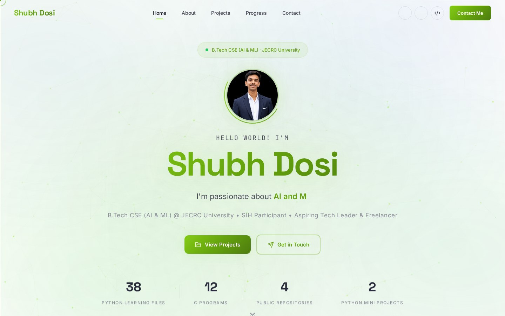

# Shubh Dosi — Personal Developer Portfolio

My personal developer portfolio website, designed and built by me to present my background, learning journey, technical skills, and projects.

**Repository:** https://github.com/shubhdosi012/my-portfolio  
**GitHub profile:** https://github.com/shubhdosi012  
**LinkedIn:** https://www.linkedin.com/in/shubh-dosi-575323311/



## About this project

This is my own portfolio project, separate from my college AI-class projects made with Lovable. I built the website myself as a way to practise frontend development and present my work in one place.

The current repository contains a static frontend implemented with HTML, CSS, and JavaScript.

## Website sections and interactions

- **Home / hero:** introduction, profile image, animated text, and project/contact actions
- **About:** academic background and learning goals
- **Skills:** technologies and topics I am learning
- **Projects:** project cards and project filtering
- **Progress:** learning progress indicators
- **Blog / learning notes:** space for technical learning notes
- **Contact:** professional profile and contact links
- **Responsive navigation:** mobile menu and section navigation
- **Visual effects:** particle background, scroll reveal, count-up elements, and custom cursor on supported desktop screens

## Technology stack

- **HTML5** — page structure and content
- **CSS3** — layout, styling, responsive design, transitions and animations
- **JavaScript** — navigation, typed text, filters, counters and scroll effects
- **Lucide icons** — interface icons
- **Google Fonts** — typography

## Run locally

No build step is required for the current static version.

1. Clone the repository.
2. Open `index.html` in a browser, or use the VS Code Live Server extension.
3. Keep `style.css`, `script.js`, profile imagery, and project images alongside the HTML file.

```bash
git clone https://github.com/shubhdosi012/my-portfolio.git
cd my-portfolio
```

## What I practised

- Building and organising a multi-section website
- Responsive design and CSS layout
- JavaScript DOM manipulation and event handling
- Navigation and interactive UI behaviour
- Animations and visual design
- Presenting projects clearly with Git and GitHub

## Future improvements

- Add a verified live deployment URL when available
- Link each project to its repository and demo
- Check keyboard navigation, contrast, reduced-motion preferences and mobile layouts
- Keep skills and progress claims accurate and up to date

## Project note

This is my personally built portfolio project. My separate college AI-class projects built with Lovable are documented in their own repositories, including [E-Commerce Inventory Management](https://github.com/shubhdosi012/ecommerce-inventory-management) and [Shubh Dosi Verse](https://github.com/shubhdosi012/shubh-dosi-verse).
